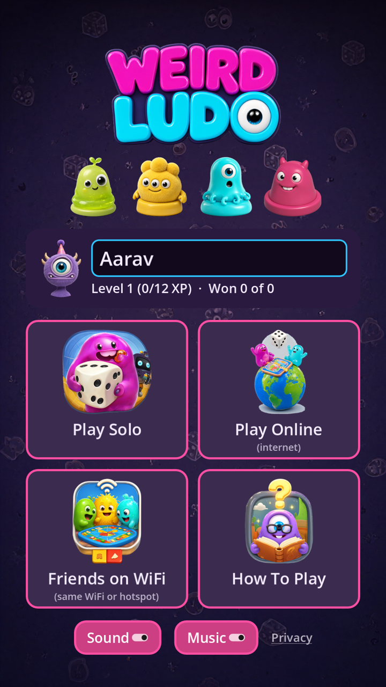
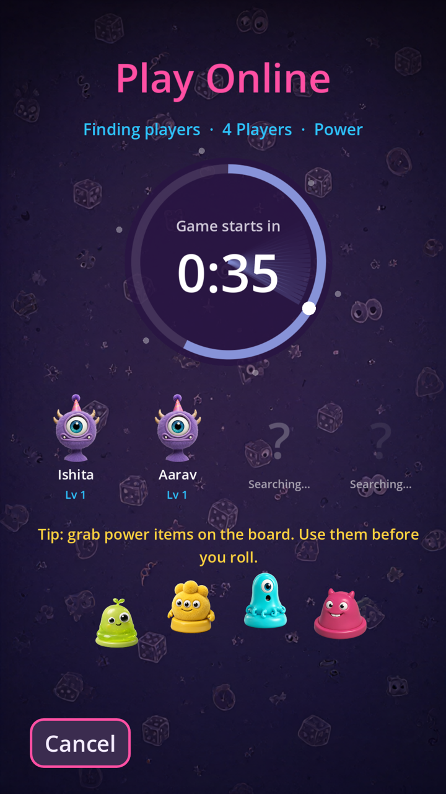
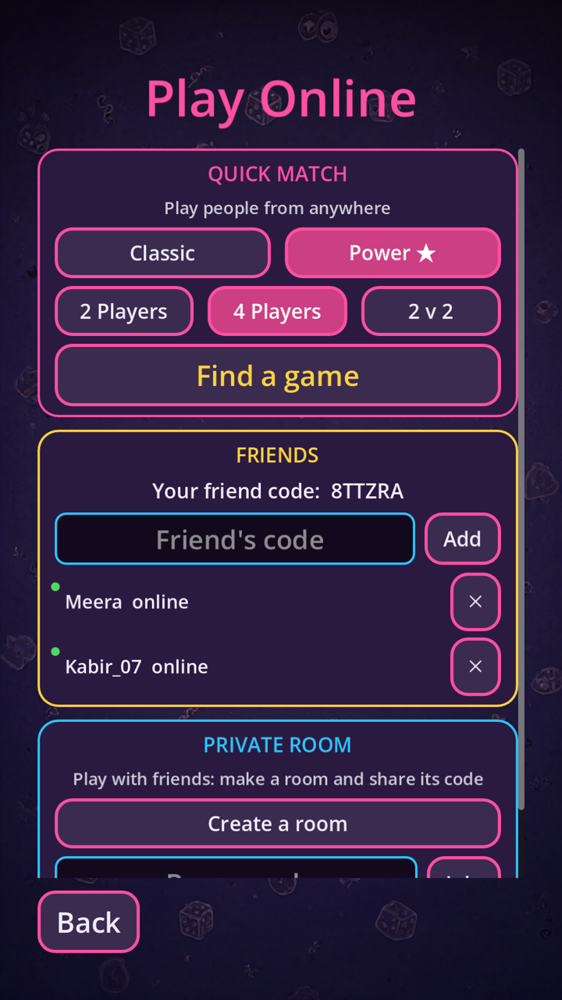
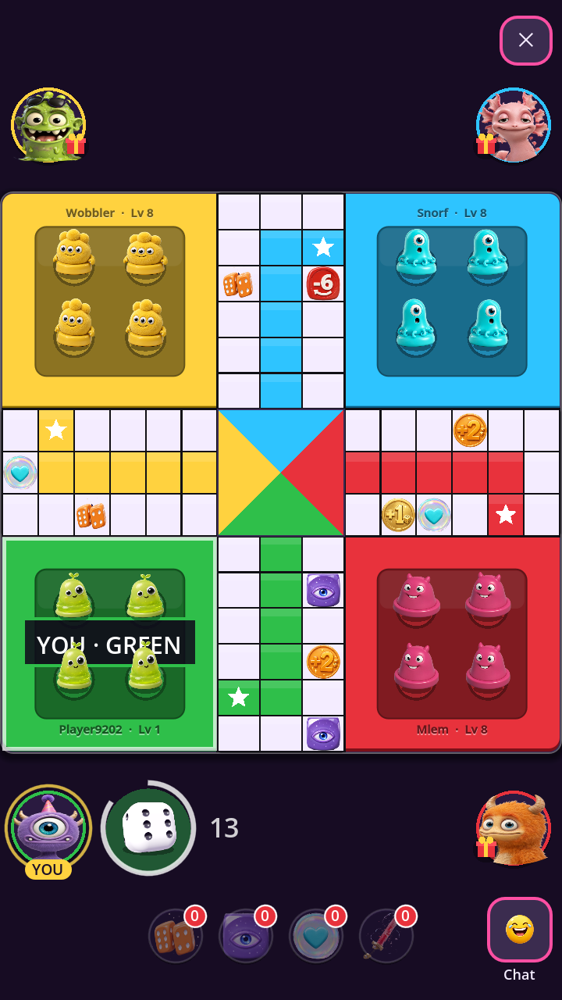
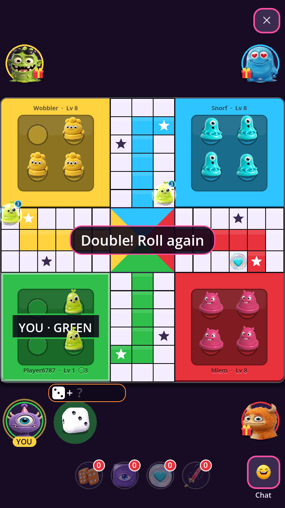
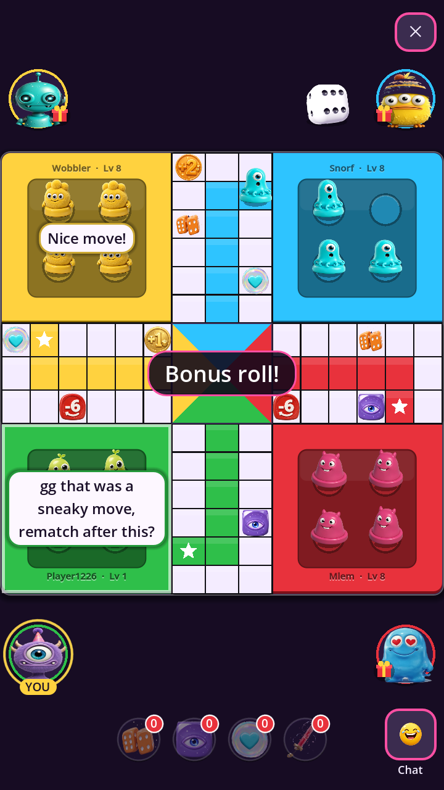
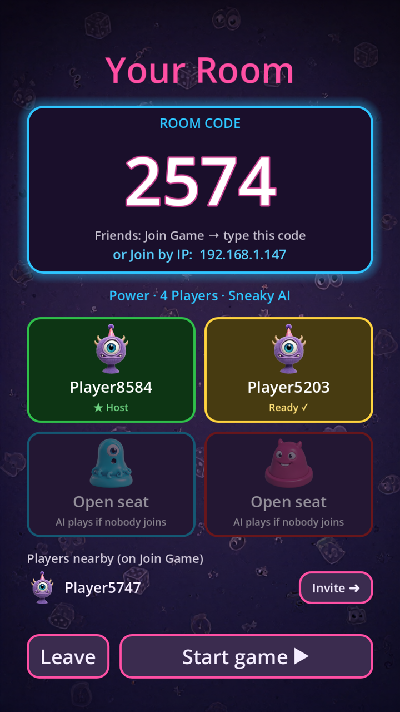
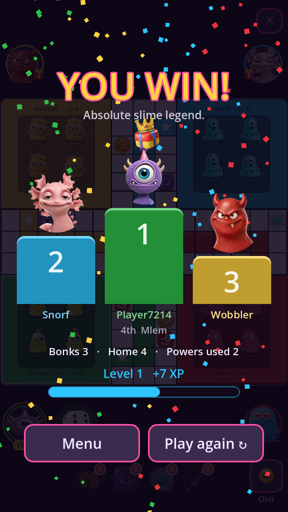
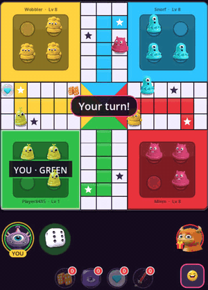
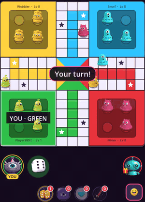

# WeirdLudo

### Ludo with slimes, powers and dice you can trust

Play people online, friends on the same WiFi, or the computer on your own. No account, no in-app purchases.

&nbsp;
&nbsp;
&nbsp;

&nbsp;
&nbsp;
&nbsp;

---

## Why Weird Ludo?

Most Ludo apps want an account and your money for "boosters". Weird Ludo keeps the classic game you know, adds a
handful of silly powers that **everyone finds on the board**, and lets you play however you like: online with
anyone, on a phone hotspot with no internet at all, or alone against the computer.

| | Typical Ludo app | **Weird Ludo** |
|---|:---:|:---:|
| Dice | You just have to trust it | ✅ Secure random generator, tested on 600,000 rolls. Online, the server rolls for everyone |
| Powers and boosters | Bought with coins or real money | ✅ Picked up on the board; everyone starts equal |
| Play with friends | Online only | ✅ Online, **or** on the same WiFi / phone hotspot with no internet |
| Account or login | Usually required | ✅ None |
| In-app purchases | Yes | ✅ None |
| Chat with strangers | Open text chat | ✅ Online it's quick lines, emoji and gifts only |
| Someone's connection drops | They lose their game | ✅ They rejoin their own seat; the computer covers meanwhile |

## See it in action

&nbsp;&nbsp;

## Play Online

Tap **Play Online** on the home screen. No account, no sign-up.

- **Quick Match:** tap *Find a game* and play people from anywhere. A game starts within a minute.
- **2 v 2 with a friend:** team up with a friend and take on another pair together.
- **Friends:** everyone gets a 6-character **friend code**. Add friends by their code, see who is online, and invite
  them into your room with one tap.
- **Private rooms:** share a 5-digit room code and play with 2, 3 or 4 friends. After each game everyone goes back
  to the room; anyone can leave, and the owner starts the next game with whoever is still there.
- **Lost your connection or closed the app?** Open Play Online again and tap **Rejoin** to get your own seat back,
  or **Leave it** to start a fresh game.
- **Safe with strangers:** online there is no typed chat, only fixed quick lines, emoji and free gifts.
  Rude player names are replaced with "Player".
- **No cheating:** the game server rolls the dice and checks every move. Phones only say what they want to do.

## Game modes

- **2 players**, **4 players**, or **2 v 2 teams** (partners sit diagonally; teammates never capture each other)
- **Classic** (plain Ludo) or **Power** mode (items and powers on the board)
- **Play Solo** against computer players at three levels: **Chill**, **Sneaky** and **Ruthless**
- **Pass & play**: up to 4 people on one phone
- A **15-second turn timer**, so nobody stalls the game. If time runs out, your best move is played for you

## Powers

In Power mode nobody starts with anything. Land on an item to collect it, then tap it **before you roll**.
You can hold up to 20 of each.

| | Power | What it does |
|:---:|---|---|
|  | **Double** | Roll twice and move one slime the total, e.g. 6 + 4 = 10 |
|  | **Mind Dice** | Pick the number you roll (1 to 6) |
|  | **Bubble Shield** | None of your slimes can be captured until your next turn; a badge counts down the turns left |
|  | **Shield Breaker** | Rare, only 2 per game. Captures straight through a Bubble Shield. If it doesn't hit a shield, you get it back |

**Board tiles** work the moment you land on them:

| | Tile | What it does |
|:---:|---|---|
|  | **+1** | One extra roll |
|  | **+2** | Two extra rolls |
|  | **−6** | Slide back 6 squares and knock out a lone rival waiting there |
|  | **Invisibility Cape** | Rare. That slime vanishes from rivals' screens and can't be captured until the end of your 2nd next turn |

## How to play

1. Roll a **6 or a 1** to bring a slime out of your yard. A 6 also gives you another roll.
2. Land on a rival's lone slime to send it back to their yard, and roll again.
3. **Stars** and **two or more slimes together** are safe from capture.
4. Three sixes in a row cancels the third roll.
5. You need the **exact roll** to reach home. Get all four slimes home to win.

The game has a **How To Play** screen with a short looping clip for every rule and power.

## Playing with friends on WiFi

Everyone needs to be on the **same WiFi network or the host's phone hotspot**. No internet is needed.

1. **Host:** tap **Play With Friends**, pick the mode and tap **Open room**. You get a 4-digit room code.
2. **Friends:** tap **Join Game**, then either type the room code, tap the room under *Rooms nearby*,
   or just wait. The host sees everyone on the Join screen under **Players nearby** and can **Invite** them in one tap.
3. Joining makes you ready automatically. The host taps **Start game**; empty seats are played by the computer.

**Built for real phones and real WiFi:**
- Phones that switch apps or turn the screen off stay in the game for up to 10 minutes and catch up when they come back.
- If a connection drops, the game keeps reconnecting for 5 minutes. If the app was closed, the home screen offers
  **Rejoin WiFi game** and puts you back in your own seat.
- While someone is away, the computer plays their turns when their timer runs out, and everyone sees who left and who's back.
- After a game, **Rematch** reopens the same room, so nobody types the code again.
- **Join by IP** is there for networks that block discovery.
- Android, macOS and Windows use the same network protocol, so they can share a room.

## More to love

- 🎲 A 3D die with **real recorded dice sounds** and an excited announcer voice
- 💬 Quick lines, 12 pop-up emoji and **8 free animated gifts** to throw at other players (WiFi games can also type messages)
- 🏆 Levels, XP and a stats card for every player, plus a podium and confetti when you win
- 🟢 Your colour is always clear: a "YOU" tag, a glowing yard and a gold ring on your avatar
- 🔊 Music and sound effects, each with its own on/off switch

## Fair dice

Every roll comes from a **cryptographically secure random number generator** (the same source used for encryption
keys), mapped to 1 to 6 without bias. The test suite rolls 600,000 times and checks the spread with a chi-squared
test. Nobody can fake a roll: **online, the game server rolls** for everyone; in WiFi games the **host's** device does.

## Download

| Platform | Where | Notes |
|---|---|---|
| **Android 7.0+** | **[Google Play](https://play.google.com/store/apps/details?id=com.rd.weirdludo)** | Recommended. Updates automatically |
| Android 7.0+ (64-bit) | `WeirdLudo-<version>.apk` from **[Releases](../../releases)** | Allow installing from this source when asked |
| macOS 11+ (Apple Silicon and Intel) | `WeirdLudo-macOS.dmg` from **[Releases](../../releases)** | First launch: right-click the app → **Open** |
| Windows 10/11 (64-bit) | `WeirdLudo-Windows.zip` from **[Releases](../../releases)** | Unzip and run `WeirdLudo.exe`. If SmartScreen appears: **More info → Run anyway** |

> Online play needs the latest version. Everyone in a WiFi game should use the **same version** of the app.
>
> The APK here and the Google Play version are signed differently, so to switch between them, uninstall one first.

## Privacy

No accounts. Your profile and stats stay on your device. WiFi games talk only to the other devices on your local
network. Online games go to our game server, which keeps your player name and moves **only in memory** while you
play and never writes them to disk. The Android version shows banner ads from Google AdMob.
Full details: **[Privacy Policy](Privacy-Policy.md)**.

## Credits

Made by **Rishabh Dahiya** · contact: rishabhdahiya.work@gmail.com

- Built with **[Godot Engine](https://godotengine.org)** 4.7 (MIT)
- Dice sounds: **[Casino Audio](https://kenney.nl/assets/casino-audio)** by Kenney (CC0)
- Characters, items and artwork created with Qwen-Image; announcer voice with Qwen3-TTS; music with ACE-Step
- Ads by Google AdMob (Android only)

Google Play and the Google Play logo are trademarks of Google LLC.

© 2026 Rishabh Dahiya
